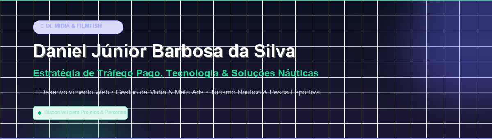

  

<h1 align="center">Olá! Eu sou Daniel Júnior Barbosa da Silva 👋</h1>

  <strong>Idealizador da DL MIDIA & da FilmFish</strong> 
  <em>Estrategista de Tráfego Pago • Desenvolvedor • Automações com Inteligência Artificial • Mercado Náutico & Pesca Esportiva</em>

  
  
  

---

### 💼 Sobre Mim & Meus Projetos

Sou o fundador e líder técnico de duas operações estratégicas:

- **🚀 DL MIDIA:** Agência de marketing de performance, tráfego pago (Meta Ads e Google Ads), inteligência artificial aplicada a vendas e desenvolvimento de sistemas sob medida para empresas, e-commerces e profissionais liberais.
- **🎣 FilmFish:** Agência de marketing, produção de conteúdo e tecnologia especializada no **mercado náutico, turismo e pesca esportiva**, atendendo pousadas, barcos-hotéis, operadores e guias de pesca em todo o território nacional.

Atuo na interseção entre **mídia de alta conversão** e **engenharia de software**, desenvolvendo ferramentas nativas para acelerar a produtividade, eliminar gargalos de atendimento e escalar negócios com previsibilidade.

---

### 🛠️ Tecnologias & Habilidades

  
  
  
  
  
  
  
  

---

### 🚀 Repositórios em Destaque

| Projeto | Descrição | Status |
| :--- | :--- | :---: |
| 🎯 [**`adpilot-ai`**](https://github.com/DLMIDIA/adpilot-ai) | Navegador Workspace Chromium nativo com Copiloto IA (Gemini) integrado para tráfego pago, cofre de senhas de clientes e agendador de criativos. | `Ativo` |
| 🧹 [**`desk-organizer-mac`**](https://github.com/DLMIDIA/desk-organizer-mac) | Automação nativa para macOS que organiza instantaneamente a Área de Trabalho e a pasta Downloads em 7 categorias limpas. | `Ativo` |
| 📁 [**`drive-filesync-manager`**](https://github.com/DLMIDIA/drive-filesync-manager) | Sistema de sincronização e backup redundante de gravações, cartões de drone DJI e mídias pesadas via Google Drive. | `Ativo` |
| 🎣 [**`filmfish-contratos-pesca`**](https://github.com/DLMIDIA/filmfish-contratos-pesca) | Plataforma de emissão de orçamentos, contratos de turismo náutico e termos de adesão para pesca esportiva com PDF automático. | `Ativo` |
| 📸 [**`instasaver-pro`**](https://github.com/DLMIDIA/instasaver-pro) | Extensão avançada para salvamento e gerenciamento de mídias de alta resolução do Instagram. | `Ativo` |

---

### 📊 Estatísticas no GitHub

  
  

---

  <em>Desenvolvido com excelência por <strong>Daniel Júnior Barbosa da Silva</strong> • DL MIDIA & FilmFish</em>

